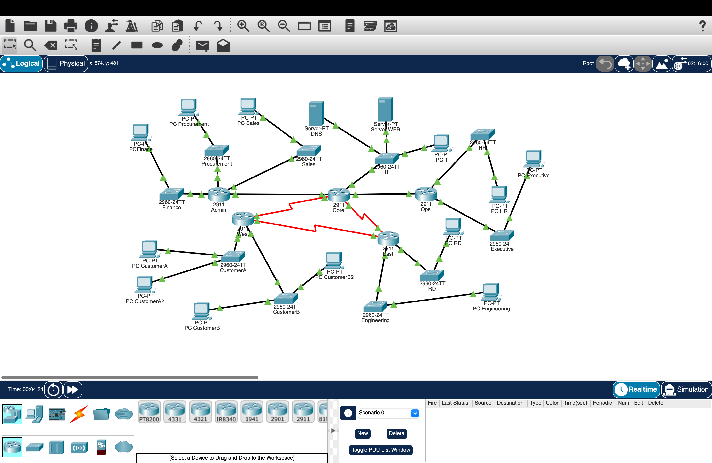

# Enterprise Multi-Site Network — Cisco Packet Tracer

A five-router, ten-LAN network designed in Cisco Packet Tracer for the CMP3044
Foundation Networks unit at AIT Sydney. The fictional brief modelled Kestrel Industries,
whose offices and departments needed automatic addressing, internal name resolution,
web access and communication across multiple sites.

## In plain English

The project turns a written business scenario into a logical network. Larger departments
receive larger address blocks through VLSM, routers connect the sites, DHCP assigns host
addresses, DNS resolves internal names and an internal server provides a basic web service.

## Repository scope

This public repository contains the project explanation, topology image and a repeatable
verification checklist. The original Packet Tracer file, router configurations and VLSM
worksheet were submitted through the university portal and are not currently available
here.

That means the design can be reviewed, but it cannot yet be rebuilt or independently
tested from this repository alone. Adding a sanitised `.pkt` file, address table and
configuration exports is the main remaining improvement.

## Architecture

| Layer | Components | Purpose |
| --- | --- | --- |
| Backbone | Core, Admin, Ops, West and East routers | Connect the five network areas and provide alternate WAN paths |
| Access | Ten Cisco 2960 switches | Connect department hosts and services to their local router |
| LANs | Finance, Procurement, Sales, IT, HR, Executive, Engineering, R&D, Customer A and Customer B | Separate business groups with different host requirements |
| Services | DHCP, DNS and internal web server | Provide addressing, name resolution and an internal application endpoint |
| Addressing | VLSM plan | Allocate subnet sizes according to department demand |

The public artifact confirms the logical device layout. The exact IP ranges and routing
protocol are not documented publicly, so this README does not guess them.

## Network topology

The red links in the screenshot are serial WAN connections in Packet Tracer; the black
links are Ethernet connections. Green interface indicators show that the visible links
were up when the screenshot was captured.

## Design approach

1. Translate departments and expected host counts into LAN requirements.
2. Order the LANs from largest to smallest.
3. Allocate VLSM blocks without overlap and reserve gateway addresses.
4. Connect each access LAN to its local router.
5. Configure inter-router links and routing.
6. Add DHCP pools, DNS records and the internal web service.
7. Validate one layer at a time: interface, local gateway, remote network, DNS and HTTP.

The commands and end-to-end checks are documented in
[`docs/verification-checklist.md`](docs/verification-checklist.md).

## What I learned

- Converting a business brief into a network topology and addressing plan.
- Using VLSM to match subnet size to host demand.
- Configuring routers, DHCP pools and internal services in Packet Tracer.
- Troubleshooting from the local interface outward instead of changing several settings
  at once.
- Recognising that a screenshot is useful evidence, but not a substitute for versioned
  configurations and repeatable tests.

## Current limitations

- No public `.pkt` file.
- No public subnet allocation table.
- No router or switch configuration exports.
- No saved ping, traceroute, DNS or HTTP test evidence.
- Packet Tracer version used for the original submission is not recorded.

## Next improvement

If the original assessment files are recovered, the next release should add them in one
commit together with a redacted addressing table, device configuration exports and a
short verification report. Until then, this repository should be treated as a documented
design artifact rather than a fully reproducible lab.

---

Willian Yudy Futema · [Portfolio](https://willian-yudy-f.github.io/) ·
[LinkedIn](https://www.linkedin.com/in/willian-yudy-futema/)
